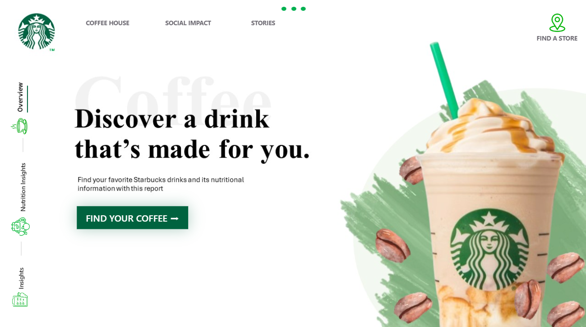
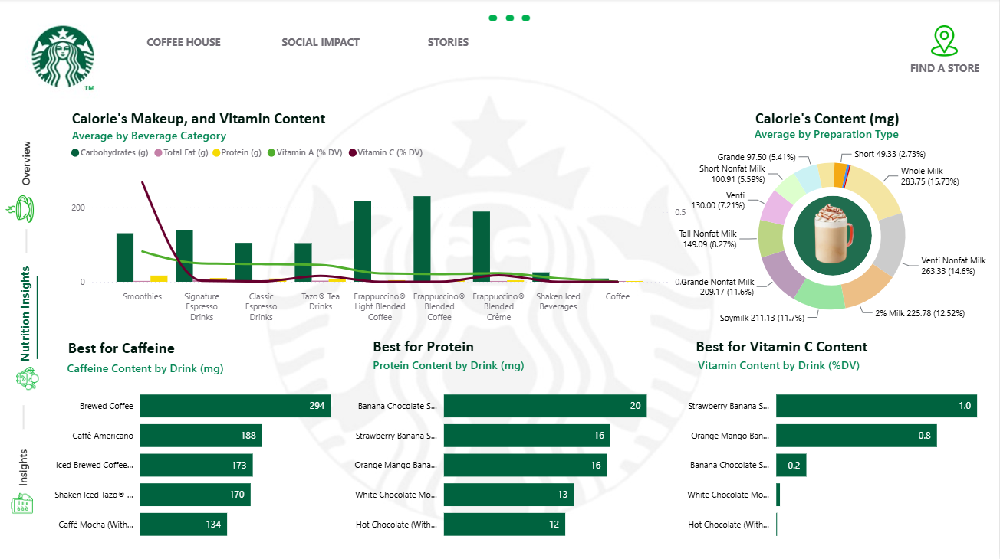
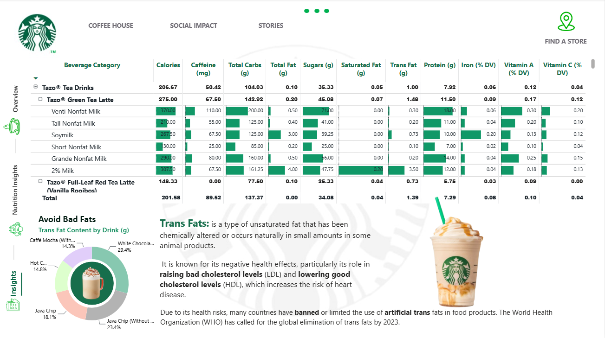
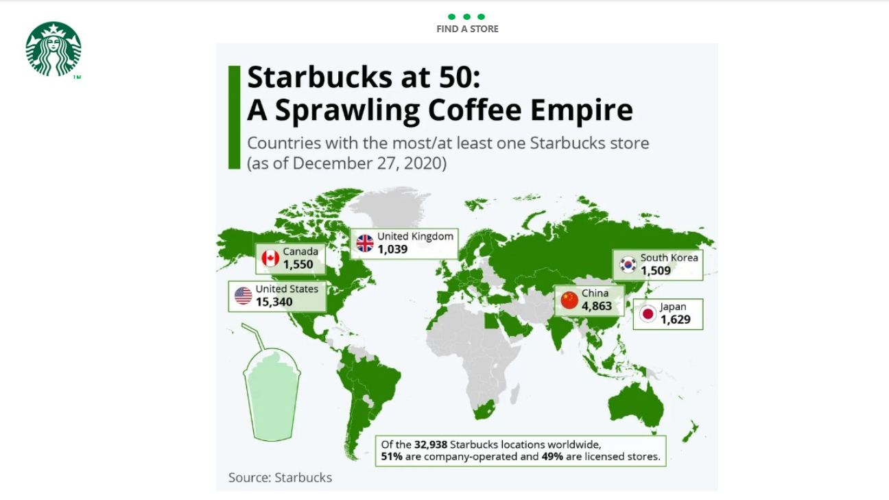

# Starbucks Drinks Dashboard

An interactive Power BI report for exploring the nutrition of Starbucks drinks: calories, caffeine, protein, vitamins and fats, broken down by beverage category, size and milk type.



An interactive [HTML preview](Previews/preview.html) is also included: a drink explorer with filters, a scatter plot of any two nutrients and a cup view for each drink. Open it in any browser.

## What the dashboard answers

- Which drinks give the most caffeine, protein or vitamin C?
- How do calories, carbs, fat and vitamins compare across beverage categories?
- How do size and milk choice change a drink's nutrition?
- Which drinks carry the most trans fat, and why does it matter?

## Dashboard pages

| Page | What it shows |
| --- | --- |
| Overview | Landing page with the side navigation used across the report. |
| Nutrition Insights | Calories, carbs, fat and vitamins by beverage category, calories by preparation type, and the top five drinks for caffeine, protein and vitamin C. |
| Insights | A drill-down table from category to drink to size or milk, plus a trans fat breakdown with a short explainer. |
| Store | A world map of Starbucks store counts, taken from an infographic dated December 2020. |

## Preview

### Nutrition Insights


### Insights


### Store


## Built with

- **Power BI Desktop**: report design, custom page navigation with buttons and icons, drill-down matrix, combo, donut and bar charts
- **Power Query**: loading and preparing the data
- **Python (pandas)**: generating a synthetic sample dataset with the same columns, and building the HTML preview from the CSV
- **HTML, CSS and JavaScript**: the interactive preview, drawn with plain SVG and no chart libraries

## Data

The report uses a Starbucks beverage nutrition dataset with one row per drink and preparation. Columns include beverage category, beverage, preparation, calories, fats, sodium, carbohydrates, cholesterol, fibre, sugars, protein, vitamins A and C, calcium, iron and caffeine.

- **Source:** Starbucks Beverage Components, a Kaggle dataset by henryshan ([Baselight listing](https://baselight.app/u/kaggle/dataset/henryshan_starbucks))
- **Synthetic sample:** `Scripts/dummy_data_generator.py` writes random values with the same columns to `Data/sample/`. It is for testing the report layout only. The values are random and should not be used for analysis.

## Getting started

1. Clone or download this repository.
2. Open `Dashboard.pbix` in Power BI Desktop.
3. If Power BI asks for the data source, go to **Home > Transform data > Data source settings** and point it at `Data/beverages_data.csv`.
4. Use the side navigation to move between pages.
5. To open the HTML preview, double-click `Previews/preview.html`. To rebuild it after changing the data, run `python Scripts/build_preview.py` (add `--synthetic` if the CSV is the random sample).

To recreate the folder layout from scratch, run `python Scripts/template.py`.

## Repository structure

```
Starbucks-Drinks-Dashboard/
├── README.md
├── Dashboard.pbix
├── Data/
│   ├── beverages_data.csv
│   └── sample/
│       └── beverages_data_synthetic.csv
├── Previews/
│   ├── 01_overview.png
│   ├── 02_nutrition_insights.png
│   ├── 03_insights.png
│   ├── 04_store.png
│   ├── Dashboard_Preview.pdf
│   └── preview.html
└── Scripts/
    ├── template.py
    ├── dummy_data_generator.py
    ├── build_preview.py
    └── preview_template.html
```

## Roadmap

- Add slicers for category, size, milk type and calorie range so visitors can filter to their own drink.
- Add a sugar view alongside the trans fat insight.
- Replace the static store infographic with a native map visual or a link to the official store locator.

## Disclaimer

This is an independent portfolio project and is not affiliated with or endorsed by Starbucks. The Starbucks name, logo and product images belong to Starbucks Corporation. The store map is a third-party infographic dated December 27, 2020, and its figures are out of date.

## Author

**Shubham Adate**, Data Analyst
[LinkedIn](https://www.linkedin.com/in/adate-shubham) | [GitHub](https://github.com/shubhamadatework-git)
